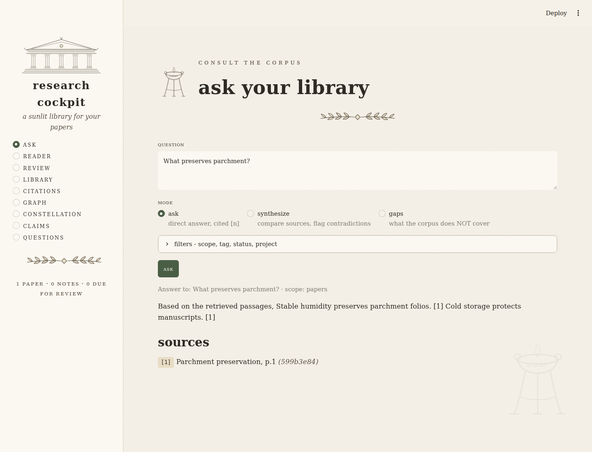

# Research Cockpit

A local-first workspace for reading papers, asking questions of your library, and
connecting evidence to research ideas. One SQLite library powers a command-line
interface and a Streamlit app.

**Status: early preview.** The offline core is tested; some advanced features are
Python-library helpers rather than complete UI workflows. See
[verification and limitations](specs/verification.md) for the current audit.



*Offline demo using a generated sample paper and the local heuristic backend.*

## What it does

- **Ask your library:** dense or hybrid search over PDFs and notes; answers with
  numbered passage references; comparison and research-gap prompts.
- **Read and organize:** PDF reader with page search, tags, projects, annotations,
  paper status, study notes, and spaced-repetition review.
- **Work with evidence:** structured paper extraction, claim/evidence outlines,
  saved research questions, and links between notes and source passages.
- **Manage references:** DOI metadata lookup, open-access PDF retrieval, BibTeX
  import/export, basic APA/MLA/Chicago formatting, and citation-graph exports.

The UI has nine pages: Ask, Reader, Review, Library, Citations, Graph,
Constellation, Claims, and Questions. OCR, section-aware chunking, watchlists,
literature-review drafts, reproducibility records, and retrieval evaluations are
also available as core Python modules; they are not all wired into the frontends.

## Install

Requires **Python 3.11+**. Run these commands from a checkout of this repository:

```bash
python3 -m venv .venv
source .venv/bin/activate
python -m pip install -e ".[ui,dev]"
```

On Windows PowerShell, activate with `.venv\Scripts\Activate.ps1`.
For CLI-only use, install with `python -m pip install -e .`.
Installation downloads dependencies, including the sentence-transformers stack.

## Try it without model downloads or API keys

Use a separate demo library so test embeddings never mix with a real library:

```bash
export RC_HOME="$PWD/.research-cockpit/demo"
rc config set embeddings.model hash
rc config set llm.backend local
printf '%s\n' 'Stable humidity preserves parchment. Cold storage protects manuscripts.' > "$RC_HOME/demo.md"
rc add-note "$RC_HOME/demo.md" --title "Preservation notes" --tag demo
rc search "parchment" --scope notes
rc ask "What preserves parchment?" --scope notes
rc ui
```

Open **http://127.0.0.1:8501**. In Ask, expand the filters and set **Scope** to
**notes** or **all** for this demo. Stop the server with Ctrl-C.

`hash` is a deterministic word-overlap embedder; `local` extracts sentences using
heuristics. They verify the workflow without semantic models or an LLM.

## Use your own papers

Start a normal library in a fresh shell, or leave the demo configuration with:

```bash
unset RC_HOME
rc add --no-resolve /path/to/paper.pdf
rc search "your research question"
rc ui
```

The normal embedding model is `BAAI/bge-small-en-v1.5`. Its weights download on
first use, then inference runs locally. **Choose your embedding model before
adding content.** There is no reindex command or persisted model identity yet;
changing models on a populated database can break search or invalidate scores.
Use a separate `RC_HOME` when trying another model.

Omit `--no-resolve` to allow online metadata lookup. DOI ingestion always needs
network access and creates a metadata-only record when no open-access PDF is
available:

```bash
rc add 10.48550/arXiv.1706.03762
rc kb list
```

Image-only PDFs need OCR before ingestion. Install the optional extra with
`python -m pip install -e ".[ocr]"`, install OCRmyPDF's required system tools,
then run `ocrmypdf input.pdf searchable.pdf` and add `searchable.pdf`.
Normal ingestion does not automatically run OCR.

## Configure answers

The default is the `claude-cli` adapter with a local heuristic fallback. Configure
an authenticated CLI or an API backend for generated answers; use
`rc config set llm.backend local` for the offline heuristic backend.

| Backend | Configuration | Requirement |
| --- | --- | --- |
| Claude CLI | `rc config set llm.backend claude-cli` | Authenticated `claude` executable on PATH |
| Codex CLI | `rc config set llm.backend codex-cli` | Authenticated `codex` executable on PATH |
| API | `rc config set llm.backend api` | Provider, available model, and environment API key |
| Local heuristic | `rc config set llm.backend local` | No external service |

Set `llm.model` to a model your provider/account supports. The inherited Claude
model default has not been verified against a live service in this audit.
For the API adapter, `llm.api_provider` accepts `anthropic` or `openai`; keys come
from `LLM_API_KEY`, `ANTHROPIC_API_KEY`, or `OPENAI_API_KEY` in the environment.
The application does not read `.env` files automatically.

Backend failure can trigger the local fallback, with a warning. To make failures
stop the operation, set `rc config set llm.fallback_backend ""`.
Generated references point back to retrieved passages, but factual support and
invented citation markers are not automatically validated. Check the passages.

## Common workflows

Replace `PAPER_ID` and `CLAIM_ID` with IDs from the relevant list command; unique
ID prefixes work too. Documents can also be selected by exact title or DOI.

```bash
# Search and answer (papers are the default scope)
rc search "contrastive pretraining"
rc ask "Compare the evaluation methods" --synthesize
rc ask "coverage" --gaps "robustness"
rc config set rag.retrieval hybrid

# Reading status and notes
rc kb list
rc kb status PAPER_ID reading
rc kb annotate PAPER_ID "Key result: ..." --page 4
rc kb show PAPER_ID
rc kb meta PAPER_ID
rc kb enrich PAPER_ID
rc review

# Projects and evidence
rc project add thesis --description "Chapter 2 reading set"
rc project assign PAPER_ID thesis
rc claim add thesis "The corpus supports this claim."
rc claim list thesis
rc claim attach CLAIM_ID PAPER_ID "An exact supporting passage" --page 4
rc extract run PAPER_ID
rc extract show PAPER_ID

# References and graphs
rc bib import references.bib
rc bib export -o library.bib
rc bib cite --style apa
rc graph build
rc graph clusters
rc graph gaps
rc graph export -o graph.graphml
```

`kb enrich` and `extract run` use the configured generation adapter; the local
heuristic backend does not support full structured paper extraction. `graph build`
contacts metadata services. Graph export also supports `.dot` and `.json`.
Run `rc --help` or `rc <command> --help` for available options.

## Data and configuration

By default, application data lives in `~/.research-cockpit/`:

| Location | Contents |
| --- | --- |
| `config.toml` | Backend, retrieval, storage, and UI settings |
| `rc.db` | Documents, chunks, vectors, annotations, and research records |
| `papers/` | PDFs uploaded through the UI or downloaded by DOI |

`RC_HOME` changes the application directory; an explicitly configured `store.path`
overrides the database location. PDFs added from the CLI retain their original
absolute paths, so keep those files available for the Reader. To back up a library,
stop the app and copy its data directory plus any externally referenced PDFs.

```bash
rc config show
rc config set rag.top_k 8
rc config set ui.port 8502
```

Other settings include `rag.chunk_tokens`, `rag.chunk_overlap`, and `rag.rerank`.
Reranking applies to hybrid retrieval and downloads a local cross-encoder on first
use. Some UI ingestion paths still use default chunk settings; see the audit.

Storage, embedding inference, and OCR are local. Initial model downloads require
network access. Metadata lookups send identifiers or titles to external services;
remote generation sends the prompt and retrieved passages to the configured
backend. The UI binds to loopback, and `rc ui` disables Streamlit usage statistics.
The legacy Semantic Scholar key setting (`citations.s2_api_key`) can be persisted
in config, so treat that file as private. LLM API keys are environment-derived.

## Development and verification

```bash
python -m ruff check src tests tools/smoke.py
python -m pytest -q
python -m pip check
python -m build
python -m pip install --force-reinstall --no-deps dist/research_cockpit-0.1.0-py3-none-any.whl
python tools/smoke.py
```

The last two commands test the built wheel outside the source tree, using a
throwaway library. Restore editable development afterward with
`python -m pip install -e ".[ui,dev]"`.

Tests use temporary databases, hash embeddings, and fake/local adapters. They do
not require model downloads or API keys. Install the UI extra to include Streamlit
AppTest coverage. GitHub Actions runs lint, tests, package builds, and the installed
CLI smoke check on Python 3.11 and 3.13.

| Directory | Purpose |
| --- | --- |
| `src/research_cockpit/` | Shared core and CLI |
| `src/research_cockpit/ui/` | Streamlit app and vector ornaments |
| `tests/` | Core, regression, and UI tests |
| `tools/smoke.py` | Offline installed-package smoke check |
| `tools/extract_pdf_repo.py` | Original handoff reconstruction utility |
| `specs/` | Architecture notes, historical review, and current verification |

See [the build spec](specs/research-cockpit-spec.md),
[design notes](specs/design-notes.md), and
[GitHub preparation commands](specs/github-release.md).
The original handoff PDF is intentionally excluded from Git and distributions.

